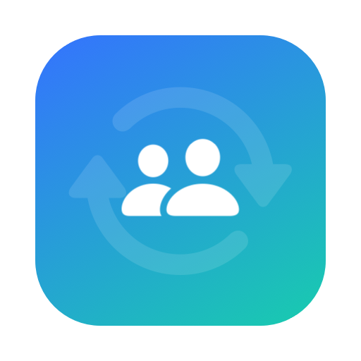

# ContactMirror

**A menu bar app for macOS that keeps your Google account and iCloud identical: Contacts ↔ Contacts, Calendar ↔ Calendar, and Tasks ↔ Reminders.**

ContactMirror runs quietly in the menu bar, starts at login, and every 30 minutes (you can change this) does a two-way sync. Adds, edits and deletions on either side show up on the other. It updates itself from this repository's GitHub releases. You can turn each of Contacts, Calendars and Tasks on or off.

- **Two-way sync.** A contact added, edited or deleted in Google appears the same way in iCloud, and the reverse.
- **Field-level merging.** If you edit a phone number on your iPhone and a job title in Gmail between two syncs, both edits are kept. If the *same* field changed on both sides, your chosen side wins (Google by default).
- **Smart first sync.** Contacts that already exist on both sides are matched by email, phone or name and merged without losing data instead of being duplicated.
- **Safe by design.** Before any sync that changes something, ContactMirror backs up both address books as vCard + JSON. If a sync would delete an unusually large number of contacts, it pauses until you confirm.
- **Always on.** Opens at login, keeps running in the background (App Nap is disabled), and catches up after the Mac wakes from sleep.
- **Self-updating.** Checks GitHub Releases every 6 hours and can install updates automatically. An update is only installed if it's signed with the same certificate as the running app.

## What gets synced

### Contacts

| Synced | Not synced |
| --- | --- |
| Name, prefix/suffix, middle name, phonetic names, nickname | Google labels / Apple groups |
| Company, department, job title | Google "Other contacts" (auto-saved addresses) |
| Emails, phone numbers, postal addresses, URLs (with labels) | Social profiles |
| Birthday, anniversaries and other dates | Notes, when macOS doesn't give apps access to them (ContactMirror detects this and leaves notes untouched on both sides) |
| Related names, instant-messaging handles | |
| Contact photos | |

### Calendars (Google Calendar ↔ iCloud Calendar)

- **Pairing:** every calendar you own in Google is paired with an iCloud calendar of the same name, and the other way round. Your main Google calendar pairs with your default iCloud calendar. Calendars that exist on only one side are created on the other.
- **Synced:** title, location, notes, URL, start/end, all-day, time zone, busy/free, recurring events (repeat rules), and moved or edited single occurrences.
- **Range:** events from 1 year ago to 2 years ahead.
- **Invitations:** events you were invited to but don't organise are copied as-is and kept matching the original, but ContactMirror never edits or deletes the original invitation.
- **Not synced:** alerts (each side keeps its own), attendees, attachments, video-call links, and colours. Google birthday and working-location entries are skipped.
- **Recurring events:** deleting a single occurrence in Google is mirrored to iCloud. Apple doesn't let apps see single deleted occurrences, so deleting one occurrence on the iPhone/Mac isn't copied to Google. Deleting or editing the whole series works both ways.

### Tasks (Google Tasks ↔ iCloud Reminders)

- **Pairing:** task lists pair with Reminders lists the same way calendars do. "My Tasks" pairs with your default Reminders list.
- **Synced:** title, notes, due date and done/not done.
- **Due times:** Google Tasks only stores a due *date*, so a reminder's time of day stays on the Apple side.
- **Not synced:** subtasks (both appear as normal items), priorities and flags.

Anything ContactMirror doesn't sync stays exactly as it was on both sides.

## Requirements

- macOS 13 Ventura or newer (Apple silicon or Intel).
- iCloud Contacts, Calendars and Reminders turned on for this Mac (**System Settings → [your name] → iCloud**).
- A Google account, plus a free Google Cloud OAuth client (one-time setup, about 5 minutes; see below).

## Install

1. Download `ContactMirror.zip` from the [latest release](https://github.com/channelramble/ContactMirror/releases/latest), unzip it, and drag **ContactMirror.app** into **/Applications**.
2. The app isn't notarized by Apple, so the first launch needs one extra step. Either:
   - Right-click the app → **Open** → **Open**, or on macOS 15+ try to open it, then go to **System Settings → Privacy & Security** and click **Open Anyway**; **or**
   - Run `xattr -dr com.apple.quarantine /Applications/ContactMirror.app` in Terminal.

   You only do this once. Later updates are installed by the app itself.
3. ContactMirror adds a 👥 icon to the menu bar and opens its Settings window. When asked, allow access to Contacts, Calendars and Reminders (choose "Allow Full Access").

## Setup

### 1. Create your Google OAuth client (one time, about 5 minutes)

Google only lets an app read and write your contacts through an OAuth client registered in Google Cloud. It's free. The client belongs to you, so nobody else's app ever sees your contacts.

1. Open the [Google Cloud console](https://console.cloud.google.com/projectcreate) and create a project (any name, e.g. *ContactMirror*).
2. Enable three APIs (make sure your new project is selected each time and click **Enable**): [People API](https://console.cloud.google.com/apis/library/people.googleapis.com), [Google Calendar API](https://console.cloud.google.com/apis/library/calendar-json.googleapis.com) and [Google Tasks API](https://console.cloud.google.com/apis/library/tasks.googleapis.com).
3. Set up the consent screen: go to [Google Auth Platform → Overview](https://console.cloud.google.com/auth/overview) → **Get started**.
   - App name: `ContactMirror`; support email: your address.
   - Audience: **External**.
   - Contact email: your address → agree → **Create**.
4. On [Branding](https://console.cloud.google.com/auth/branding), set the home page to `https://github.com/channelramble/ContactMirror`, the privacy policy to `https://github.com/channelramble/ContactMirror/blob/main/PRIVACY.md`, and add `github.com` under Authorized domains. Google requires these before you can publish.
5. **Publish the app.** Go to [Audience](https://console.cloud.google.com/auth/audience) and click **Publish app** → **Confirm** so the status reads *In production*.
   > ⚠️ Don't skip this step. In *Testing* mode Google expires your sign-in every 7 days and syncing stops. You don't need Google's verification for personal use; you'll just see a "Google hasn't verified this app" screen once when you sign in.
6. Create the client: go to [Clients](https://console.cloud.google.com/auth/clients) → **Create client**.
   - Application type: **Desktop app**; name: `ContactMirror` → **Create**.
   - Copy the **Client ID** and **Client secret**.

### 2. Connect your accounts

1. In ContactMirror, open **Settings → Accounts**.
2. Paste the Client ID and Client secret → **Save**.
3. Click **Sign in with Google**. Your browser opens. Choose your account; if you see *Google hasn't verified this app*, click **Advanced → Go to ContactMirror (unsafe)**. That warning only means the app hasn't gone through Google's verification. Then tick **Select all** so ContactMirror can access Contacts, Calendar and Tasks, and click **Continue**.
4. Under **iCloud Contacts**, check that the account named **iCloud** is selected.
5. Click **Sync Now** on the General tab, or just wait. The first sync starts automatically.

> **Tip:** if you've also added your Google account to this Mac under **System Settings → Internet Accounts**, turn off *Contacts*, *Calendars* and *Reminders* for it there. Otherwise the Mac apps show everything twice: once from Google, once from iCloud. ContactMirror only ever touches your iCloud data.

## Settings

- **General:** sync status, *Sync every N minutes* (1–1440, default 30), pause automatic sync, open at login, which side wins conflicts, the backups folder, and reset sync links.
- **Accounts:** Google OAuth client and sign-in; Contacts permission and which Contacts account is "iCloud".
- **Updates:** automatic checking and installing, *Check Now*, release notes.
- **Activity:** a live log of what each sync did. The full log is at `~/Library/Logs/ContactMirror.log`.

## How syncing works

ContactMirror remembers which Google contact is linked to which iCloud contact, plus a fingerprint of each side as of the last sync (`~/Library/Application Support/ContactMirror/`). On each run it:

1. Downloads all Google contacts (People API) and reads the iCloud account through the macOS Contacts framework. macOS then syncs those changes to iCloud and your other devices.
2. For each linked pair, compares each side with its last fingerprint:
   - Only Google changed → copy to iCloud. Only iCloud changed → copy to Google.
   - Both changed → three-way merge field by field; if both changed the same field, the preferred side wins.
   - Deleted on one side and unchanged on the other → delete it there too. Deleted on one side but edited on the other → keep the edited contact and recreate it.
3. New contacts on either side are matched to existing ones by email, then phone, then a unique name. Matches are merged; everything else is created on the other side.
4. Photos are compared the same way and copied in whichever direction they changed.

Calendars and task lists work the same way: each pair has its own sync state.

**Safety:** a sync that would delete more than 20% of a calendar, list or address book (or more than 10 items) stops and asks you first (menu → *Review Paused Deletions…*). The 15 most recent backups are kept in `~/Library/Application Support/ContactMirror/Backups/`. Each holds `contacts-google.vcf` and `contacts-icloud.vcf`, which you can re-import into either service, plus JSON files with every synced field of each contact, event and task.

## Updates

The app checks `https://api.github.com/repos/channelramble/ContactMirror/releases/latest`. When a newer version exists, it downloads `ContactMirror.zip`, checks that the new app satisfies the running app's code-signing *designated requirement* (same bundle ID, same certificate), swaps the app bundle and relaunches. An update signed by anyone else is rejected.

## Building from source

Requires Xcode 15 or newer (or the matching command line tools).

```bash
swift test                 # sync engine unit tests
./scripts/build-app.sh     # -> dist/ContactMirror.app and dist/ContactMirror.zip (ad-hoc signed)
```

To produce a build that can self-update, sign it with the release certificate:

```bash
SIGN_IDENTITY="ContactMirror Code Signing" SIGN_KEYCHAIN=/path/to/signing.keychain-db ./scripts/build-app.sh
```

`CONTACTMIRROR_PREVIEW=1 dist/ContactMirror.app/Contents/MacOS/ContactMirror` launches the UI without syncing, registering a login item or asking for Contacts access.

### Releasing

```bash
scripts/release.sh 1.1.0 "What changed"
```

This runs the tests, builds a universal binary signed with the release certificate, tags `v1.1.0`, and publishes the GitHub release with `ContactMirror.zip`. Every installed copy then updates itself. The signing certificate stays on the maintainer's Mac (`~/.contactmirror-signing`). It's self-signed, not an Apple Developer ID; its only job is to make sure updates come from the same publisher.

## Project layout

```
Sources/ContactMirrorCore/   sync engine, Google People API client + OAuth, Contacts.framework provider, updater
Sources/ContactMirror/       SwiftUI menu bar app and settings window
Sources/ObjCSupport/         tiny helper that turns Objective-C exceptions into Swift errors
Tests/                       sync engine tests (mock providers)
scripts/                     build, release and icon scripts
```

## Privacy

ContactMirror has no server. Your contacts go directly between your Mac, Google's API and iCloud (through macOS). The Google refresh token and client secret are stored in your login Keychain. The only other network request is the GitHub release check.

## License

MIT
